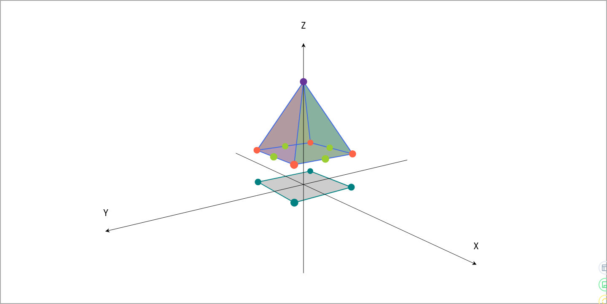
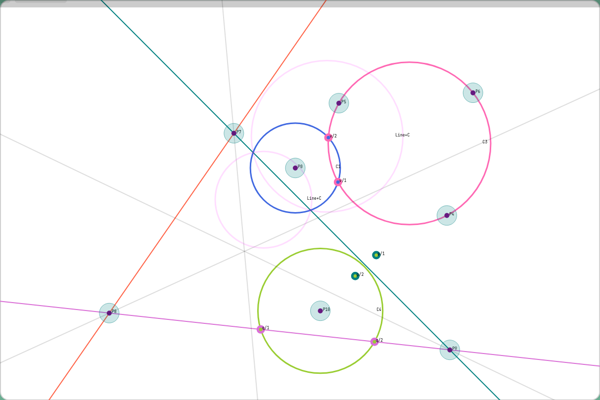

# Galixir


[](https://hex.pm/packages/galixir)

Geometric Algebra implementation in Elixir.

Generate a concrete algebra with `Galixir.GeometricAlgebra`:

```elixir
defmodule Example.PGA3 do
  use Galixir.GeometricAlgebra,
    metric: {1, 1, 1, 0},
    bases: {"1", "2", "3", "0"}
end
```

The package already provides `Galixir.Algebras.PGA3`, which adds point, motor, and geometry helpers to the generated operations. For example, align two pairs of corresponding points and transform a third point:

```elixir
alias Galixir.Algebras.PGA3

from = [PGA3.point(0, 0, 0), PGA3.point(1, 0, 0)]
to = [PGA3.point(0, 0, 0), PGA3.point(0, 1, 0)]
motor = PGA3.align(from, to)

PGA3.point(1, 0, 0)
|> PGA3.transform(motor)
|> PGA3.point_coordinates()
# => {0.0, 1.0, 0.0}
```

## Installation

```elixir
def deps do
  [
    {:galixir, "~> 0.34.0"}
  ]
end
```

The package includes projective (`PGA2`, `PGA3`, `PGA4`), conformal (`CGA2`, `CGA3`), and Euclidean vector (`Vector2`, `Vector3`) algebras. The generated core provides multivector operations; the concrete modules offer different sets of higher-level geometry helpers. `Complex1` represents complex numbers as a geometric algebra. See the [introduction](./guides/introduction.md) for where to start.

Contributions are welcome. See [Contributing](./CONTRIBUTING.md) for setup,
validation commands, numerical conventions, and release checks.

Licensed under the [Apache License 2.0](https://www.apache.org/licenses/LICENSE-2.0).
The full license text is included in `LICENSE`.

## Example

[This Livebook](./guides/example.livemd) uses 3D projective geometric algebra (`PGA3`) to render a scene as SVG. Open it in Livebook to use the interactive camera controls.

## 3D Projective Geometric Algebra





## 2D Conformal Geometric Algebra




